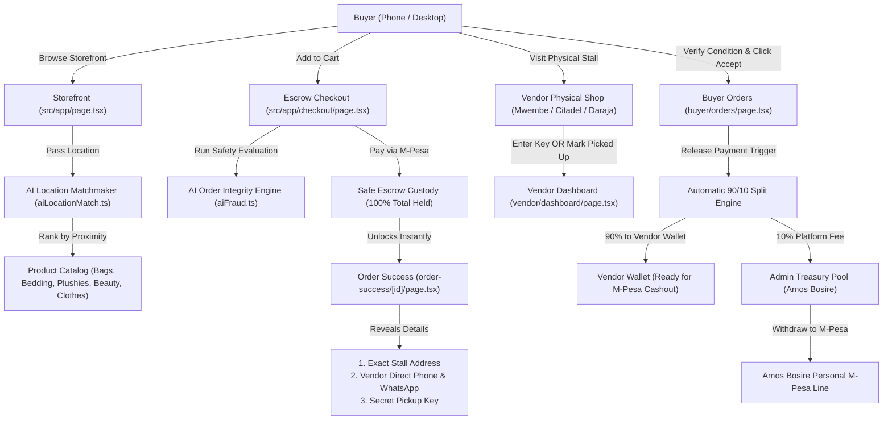
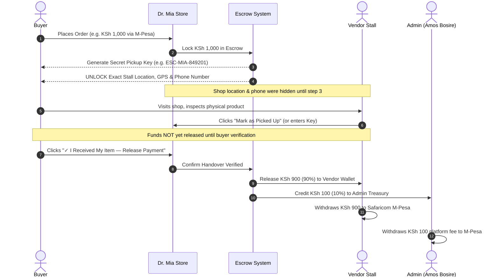
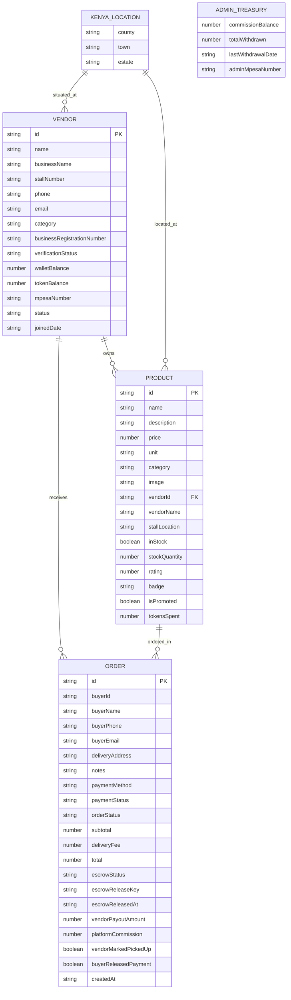

# Dr. Mia Store — Comprehensive Technical Architecture, Code Breakdown & Debug Manual

---

## 1. System Overview & Technology Stack

**Dr. Mia Store** is an escrow-protected local e-commerce platform built specifically for Kenyan towns and estates. It connects verified local physical shop stalls with buyers through an intelligent AI proximity matchmaker, holds payments safely in escrow, keeps physical shop locations and vendor contacts locked until payment is made, and enforces a verified handover flow (90% vendor payout / 10% platform service fee).

### Frameworks & Libraries Used

| Layer | Technology | Version | Purpose |
| :--- | :--- | :--- | :--- |
| **Framework** | **Next.js (App Router)** | `15.5.29` | Server and client rendering, file-based routing, static optimization |
| **Core UI Library** | **React & React-DOM** | `19.0.0` | Declarative component UI and reactive state hooks |
| **Language** | **TypeScript** | `5.8.3` | End-to-end type safety across products, orders, vendors, and locations |
| **Styling** | **Vanilla Modern CSS** | `CSS3` | Custom design system (`globals.css`) with CSS variables, responsive grid, glassmorphism, and hardware-accelerated animations |
| **Persistence Engine** | **Browser LocalStorage + Event Bus** | `HTML5 Web Storage` | Zero-database local persistence with reactive custom events (`window.dispatchEvent(new Event(...))`) |
| **Build & Tooling** | **Node.js + npm + Next CLI** | Modern | Packaging, bundling, optimization, and production generation |

---

## 2. System Architecture & Workflows (Diagrams)

### 2.1 Complete System Architecture Diagram



---

### 2.2 90/10 Escrow Payment Lifecycle Sequence



---

### 2.3 Entity-Relationship (ER) Data Model



---

## 3. The AI Engines Used

The application utilizes two specialized internal AI engines:

### 3.1 AI Location Matchmaker (`src/lib/aiLocationMatch.ts`)
* **Purpose:** Matches the buyer’s live selected Kenyan estate/town with nearby registered physical shops.
* **Proximity Logic:**
  * **Level 1 (Exact Estate Match):** Score `99%` — Distance `< 0.8 km` (`~5 mins walk`). Direct neighborhood match.
  * **Level 2 (Same Town Match):** Score `88%` — Distance `~1.5 - 3 km` (`~10 mins`). Fast local collection.
  * **Level 3 (Same County Match):** Score `70%` — Distance `~15 - 30 mins`. Regional district pickup.
  * **Level 4 (Cross County):** Score `40%`. Inter-county dispatch.
* **Combined Ranking Formula:**
  $$\text{Final Ranking Score} = \min(100, \text{Proximity Score} + \text{Token Boost Bonus})$$
  * Promoted products with tokens spent receive a +15 point ranking boost, but proximity is preserved so buyers always see the closest shops first.

### 3.2 AI Order Integrity & Safety Engine (`src/lib/aiFraud.ts`)
* **Purpose:** Evaluates order parameters behind the scenes to verify legitimate Kenyan commerce telemetry without showing scary error messages to users.
* **Signals Evaluated:**
  1. **Phone Format Regex:** `/^(?:\+254|0)[17]\d{8}$/` (Validates Safaricom / Airtel format).
  2. **Cart Velocity:** Flags high single transactions over KSh 60,000 or bulk velocities over 15 units.
  3. **Location Completeness:** Flags empty or truncated estate names.
  4. **Social Engineering Keyword Scan:** Inspects notes for scam phrases.
* **Output:** Generates a structured `FraudAnalysis` object with `riskScore`, `riskLevel` (`LOW`, `MODERATE`, `HIGH`), and `recommendation` (`APPROVE`, `REVIEW`, `REJECT`).

---

## 4. Codebase Directory & Line-by-Line Breakdown

```
c:\Users\HP\OneDrive\Desktop\project X\
├── package.json                   # Dependencies, scripts, project metadata
├── tsconfig.json                  # TypeScript compiler rules & paths
├── next.config.ts                 # Next.js optimization & build settings
├── eslint.config.mjs              # Linter configuration
├── src/
│   ├── types/
│   │   └── index.ts               # Core interfaces & data contracts
│   ├── lib/
│   │   ├── locations.ts           # 12 Kenyan counties, towns & estates database
│   │   ├── aiLocationMatch.ts     # AI Proximity & Location Matchmaking Engine
│   │   ├── aiFraud.ts             # AI Order Safety & Validation Heuristics
│   │   └── data.ts                # LocalStorage persistence, seed data, escrow logic
│   ├── context/
│   │   └── AuthContext.tsx        # Global user session & location state management
│   ├── components/
│   │   └── AuthModal.tsx          # 3-role login modal (Admin, Buyer, Vendor)
│   └── app/
│       ├── layout.tsx             # Root layout with top bar, navbar & slide-out cart
│       ├── globals.css            # Custom CSS design system & glassmorphism
│       ├── page.tsx               # Storefront with dynamic category hero & AI badges
│       ├── not-found.tsx          # Custom 404 page
│       ├── products/
│       │   └── [id]/page.tsx      # Product details with locked shop notice
│       ├── checkout/
│       │   └── page.tsx           # Escrow checkout & Kenya location selector
│       ├── order-success/
│       │   └── [id]/page.tsx      # Unlocked shop details, secret key & accept button
│       ├── buyer/
│       │   └── orders/page.tsx    # Buyer orders list & "Accept and Release" trigger
│       ├── vendor/
│       │   ├── dashboard/page.tsx # Vendor stall management & "Mark Picked Up" button
│       │   ├── login/page.tsx     # Direct vendor login page
│       │   └── register/page.tsx  # New vendor stall registration page
│       └── admin/
│           ├── page.tsx           # Platform manager (Amos Bosire): Escrow, inventory, M-Pesa
│           └── login/page.tsx     # Direct admin login page
```

---

### Detailed File Descriptions

#### 1. `src/types/index.ts`
* Defines contracts for `KenyaLocation`, `UserProfile`, `Product`, `OrderItem`, `Order`, `Vendor`, `AdminTreasury`, and `FraudAnalysis`.
* Contains fields like `escrowStatus`, `escrowReleaseKey`, `vendorPayoutAmount` (90%), `platformCommission` (10%), `vendorMarkedPickedUp`, and `buyerReleasedPayment`.

#### 2. `src/lib/locations.ts`
* Structured dataset covering 12 major Kenyan counties (Kisii, Nairobi, Kiambu, Nakuru, Mombasa, Kisumu, Uasin Gishu, Machakos, Nyeri, Meru, Kakamega, Kilifi).
* Exports helper functions `getTownsByCounty(county)` and `getEstatesByTown(county, town)` to dynamically populate location dropdowns.

#### 3. `src/lib/data.ts`
* **Seed Data:** Contains initial catalog across all 5 categories (Bags & Totes, Pillows & Bedding, Plushies & Toys, Care & Beauty, Shoes & Clothes) and 3 verified local shops in Kisii (Mwembe, Daraja Mbili, Milimani).
* **`releaseEscrowWithKey(orderId, key)`:** Validates the secret key, credits 90% to vendor wallet, credits 10% to admin treasury, marks status as `Delivered`, and triggers reactive browser events.
* **`buyerAcceptAndReleaseEscrow(orderId)`:** Direct buyer confirmation flow when receiving items at the shop.
* **`vendorMarkOrderPickedUp(orderId)`:** Sets order as ready for pickup while keeping funds protected until buyer verification.
* **`withdrawAdminCommission(amount, phone)`:** Deducts available commission balance and records M-Pesa cashout details.
* **`toggleProductInStock(productId)`:** Admin inventory toggle.

#### 4. `src/context/AuthContext.tsx`
* Manages `currentUser` session, `currentLocation` (defaults to Mwembe, Kisii Town), modal visibility, and dispatches storage change events.

#### 5. `src/components/AuthModal.tsx`
* 3-tab modal for **Buyer**, **Vendor**, and **Admin (Amos Bosire)**.
* Includes 1-click quick demo buttons and full Kenyan county/town/estate selectors.

#### 6. `src/app/page.tsx`
* **Dynamic Hero Backgrounds:** Adapts hero image dynamically based on active category.
* **AI Location Matchmaker Widget:** Computes closest vendor match in real-time.
* **Shop Masking:** Explicitly hides stall numbers and phone numbers before payment.
* **Trust Ribbon:** 4-card guarantee explainer.

#### 7. `src/app/order-success/[id]/page.tsx`
* Renders the secret pickup key with a 1-click copy button.
* **Unlocked Shop Section:** Displays exact stall location, direct phone call link, and direct WhatsApp link.
* **Accept & Release Button:** Allows buyer to confirm inspection and trigger payout.

#### 8. `src/app/admin/page.tsx`
* Passkey-gated console for platform owner **Amos Bosire** (`amo123`).
* 5 dedicated tabs:
  1. **All Payments to Escrow:** Real-time log of every shilling in escrow with 90/10 split breakdown.
  2. **Products In & Out:** Inventory table with stock quantities and in-stock/out-of-stock toggles.
  3. **AI Location & Escrow Safety:** Proximity match telemetry and order safety checks.
  4. **Withdraw 10% Fee to M-Pesa:** Cashout form to transfer platform revenue to admin M-Pesa.
  5. **Registered Shops:** Approve or suspend shop stalls.

---

## 5. LocalStorage Data Tables & Attributes

All data is stored in the browser's `localStorage` under versioned keys:

### 1. `drmia_v3_products` (Table: Products)
| Attribute | Type | Description |
| :--- | :--- | :--- |
| `id` | `string` | Unique identifier (e.g. `"mia-1"`) |
| `name` | `string` | Display name of the product |
| `description` | `string` | Product details and specifications |
| `price` | `number` | Price in Kenyan Shillings (KSh) |
| `unit` | `string` | Unit of measure (`"pc"`, `"set"`, `"pair"`) |
| `category` | `string` | One of 5 categories |
| `image` | `string` | High-resolution image URL |
| `vendorId` | `string` | Foreign key referencing vendor stall |
| `vendorName` | `string` | Business name of the shop |
| `stallLocation`| `string` | Physical stall address (hidden before payment) |
| `location` | `object` | `{ county, town, estate }` |
| `inStock` | `boolean`| Available for ordering |
| `stockQuantity`| `number` | Units available in shop |
| `rating` | `number` | Customer rating (e.g. `4.9`) |
| `badge` | `string` | Optional badge tag (e.g. `"Top Seller"`) |
| `isPromoted` | `boolean`| Promoted via tokens |
| `tokensSpent` | `number` | Tokens used to boost |

### 2. `drmia_v3_orders` (Table: Orders)
| Attribute | Type | Description |
| :--- | :--- | :--- |
| `id` | `string` | Order number (e.g. `"MIA-78219"`) |
| `buyerId` | `string` | ID of buyer |
| `buyerName` | `string` | Full name of customer |
| `buyerPhone` | `string` | Safaricom phone number |
| `buyerLocation`| `object` | `{ county, town, estate }` |
| `deliveryAddress`| `string` | Detailed house/street address |
| `paymentMethod`| `string` | `"mpesa"` or `"cod"` |
| `paymentStatus`| `string` | `"Paid"` or `"Pending"` |
| `orderStatus` | `string` | `"Ready for Pickup"`, `"Delivered"`, etc. |
| `total` | `number` | Total amount held in escrow (KSh) |
| `escrowStatus` | `string` | `"HELD_IN_ESCROW"` or `"RELEASED_TO_VENDOR"` |
| `escrowReleaseKey`| `string` | Secret 6-digit key (e.g. `"ESC-MIA-849201"`) |
| `vendorPayoutAmount`| `number` | **90%** of total amount |
| `platformCommission`| `number` | **10%** of total amount |
| `unlockedVendorContacts`| `array` | Exact stall address, phone, GPS unlocked after payment |
| `vendorMarkedPickedUp`| `boolean` | Flag set when shop hands over product |
| `buyerReleasedPayment`| `boolean` | Flag set when buyer verifies and releases funds |

### 3. `drmia_v3_vendors` (Table: Vendors)
| Attribute | Type | Description |
| :--- | :--- | :--- |
| `id` | `string` | Vendor ID (e.g. `"v-vender44"`) |
| `businessName` | `string` | Shop name (e.g. `"Dr. Mia Store - Mwembe Branch"`) |
| `stallNumber` | `string` | Exact shop location (e.g. `"Shop 14, Mwembe Plaza"`) |
| `phone` | `string` | Contact phone number |
| `businessRegistrationNumber` | `string` | Registration certificate number |
| `verificationStatus` | `string` | `"Verified"` or `"Pending Review"` |
| `walletBalance` | `number` | Available balance from 90% payouts |
| `tokenBalance` | `number` | Available promotion boost tokens |
| `mpesaNumber` | `string` | Safaricom phone for withdrawals |
| `status` | `string` | `"Approved"` or `"Suspended"` |

### 4. `drmia_v3_treasury` (Table: Admin Treasury)
| Attribute | Type | Description |
| :--- | :--- | :--- |
| `commissionBalance` | `number` | Available 10% platform service fee balance |
| `totalWithdrawn` | `number` | Lifetime commission withdrawn to M-Pesa |
| `lastWithdrawalDate` | `string` | Date of last M-Pesa cashout |
| `adminMpesaNumber` | `string` | Safaricom phone of platform owner (Amos Bosire) |

---

## 6. How to Debug & Troubleshoot Every Problem

### 6.1 How to Inspect and Debug LocalStorage Data in Your Browser
1. Open the site in your browser (`http://localhost:3000` or production domain).
2. Press **`F12`** (or Right-Click -> **Inspect**).
3. Navigate to the **Application** tab (in Chrome / Edge) or **Storage** tab (in Firefox).
4. In the left sidebar, expand **Local Storage** -> `http://localhost:3000`.
5. You will see the active keys:
   * `drmia_v3_products`
   * `drmia_v3_orders`
   * `drmia_v3_vendors`
   * `drmia_v3_treasury`
   * `drmia_user_session`
   * `drmia_user_location`

### 6.2 One-Line Emergency Database Reset
If you ever encounter corrupted mock data, open the browser Console (`F12` -> **Console**) and run:
```javascript
localStorage.clear(); location.reload();
```
The application will automatically re-seed fresh, valid products, vendors, locations, and treasury records.

### 6.3 Manually Releasing Stuck Escrow Funds via Console
To force-release an order without typing the key:
```javascript
const orders = JSON.parse(localStorage.getItem("drmia_v3_orders") || "[]");
const order = orders[0]; // First order
if (order) {
  order.escrowStatus = "RELEASED_TO_VENDOR";
  order.orderStatus = "Delivered";
  localStorage.setItem("drmia_v3_orders", JSON.stringify(orders));
  window.dispatchEvent(new Event("ordersUpdated"));
  console.log("Order " + order.id + " released!");
}
```

### 6.4 Common Issues & Solutions

| Symptom | Cause | Solution |
| :--- | :--- | :--- |
| **Site can't be reached on port 3000** | Dev server stopped or port is in use | Run `cmd.exe /c "cd /d c:\Users\HP\OneDrive\Desktop\project X && npm.cmd run dev"` |
| **Changes not showing in browser** | Browser cached old JavaScript bundle | Perform a hard refresh with **`Ctrl + F5`** (or `Cmd + Shift + R`) |
| **Vendor wallet balance not updating** | Browser window event listener unmounted | Navigate to `/vendor/dashboard` or refresh the tab |
| **Admin login says unauthorized** | Passkey mismatch | Use demo password `amo123` with email `amosbosire@gmail.com` |
| **Location shows wrong town** | Stale location in storage | Click **Change Location** pill in top bar and select County -> Town -> Estate |

---

## 7. Deployment Guide & Production Domains

### 7.1 Free Production Deployment via Vercel (Recommended)
1. Open terminal on your PC:
   ```cmd
   cd "C:\Users\HP\OneDrive\Desktop\project X"
   npx vercel
   ```
2. Follow prompts:
   * Setup and deploy? -> `y`
   * Scope? -> Select your Vercel account
   * Link to existing project? -> `n`
   * Project name? -> `dr-mia-store`
   * Code directory? -> `./`
3. Your live production URL will be generated:
   ```
   https://dr-mia-store.vercel.app
   ```

### 7.2 Custom Domain Setup (e.g. `drmia.co.ke` or `drmia.store`)
1. Go to your [Vercel Dashboard](https://vercel.com/dashboard) -> Select `dr-mia-store` -> **Settings** -> **Domains**.
2. Add your custom domain (e.g., `drmia.co.ke`).
3. Add the two DNS records in your domain registrar (e.g., Safaricom Domains, Kenya Website Hosts, HostPinnacle):
   * **A Record:** `@` -> `76.76.21.21`
   * **CNAME Record:** `www` -> `cname.vercel-dns.com`
4. Vercel automatically generates free SSL certificates within 2 minutes.

---

## 8. Verification & Credentials Reference

### Demo Accounts for Testing
* **Admin (Platform Owner):** `amosbosire@gmail.com` / Password: `amo123`
* **Buyer Account:** `buyer23@gmail.com` / Password: `buy123!@1`
* **Vendor Account:** `vender44@gmail.com` / Password: `vendoe33!`

---
*Generated for Project X (Dr. Mia Store) — All rights reserved.*
